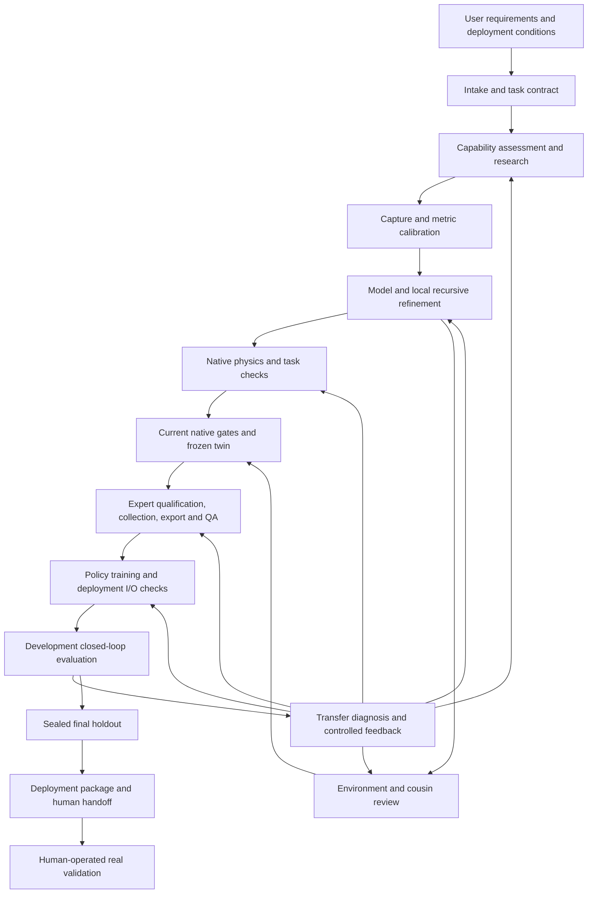

# Real2sim2real oversight

The objective is a policy and simulator that support transfer to the real task.
The controller's final claim follows the intake scope. `simulation_verification`
establishes a verified simulation pipeline while deployment I/O qualification
and real validation remain pending. A deployment-candidate contract additionally
requires its deployment I/O checks; real performance still requires actual
human-operated robot validation. Simulation score alone does not establish
transfer, and the agent must not optimize away the real task.

## Implementation and ownership

`end_to_end/src/astra_e2e/oversight/` is an agent-neutral Python/JSON controller. It validates
intake, compiles module obligations, runs explicitly authored command packets,
binds evidence, checks dependencies, accounts for evaluation trials, records
feedback and stores procedural experience. It does not embed an LLM, generate
correct task code by itself, or turn arbitrary task instructions into a trained
policy with a single shell command.

The external agent is the oversight planner and researcher. It reads the user's
requirements, resolves material uncertainties up front, configures modules,
authors unsupported adapters, executes local refinement, reviews evidence and
continues the outer loop within the agreed authority and resources. Any agent
capable of reading files and invoking the CLI can perform this role. During
research and validation, it actively searches online for relevant work and
methods when needed, using available search/browser tools. It records source
provenance, tests applicability locally and revisits research after unexplained
failures. See [the research procedure](../skills/research-transfer/SKILL.md).
The controller itself does not provide a web search client. The existing scene
MCP interface remains available for reconstruction. No provider-specific
agent API, prompt format, memory service or subagent mechanism is required.



Each module contains its own proposal → execution → numerical/semantic/native
checks → review → refinement loop. The graph controls dependencies between these
loops. It does not replace S0–S6, OBJ/SUP rounds, native material/contact checks,
task checks, data checks or checkpoint/evaluation checks.

## Configuration and runtime layout

```text
configs/workflow/intake.example.json   illustrative, intentionally unresolved
real2sim/configs/<session>/agent/                task-specific source and contracts
outputs/end_to_end/<run>/
  plan.json                            immutable requirement and dependency plan
  history/000000.json                   append-only hash-linked state snapshots
  attempts/<module>-0001/
    packet.json                        exact argv, cwd, inputs and timeouts
    command-000.log                     command output
    review.json                        immutable reviewed result, including failure
outputs/knowledge/<entry>/0001.json     scoped procedural findings and evidence
real2sim/sessions/<session>/                    native reconstruction evidence and freezes
```

Run directories are exclusive. Do not edit `plan.json` or history in place.
Contract changes require a new run; record predecessor run, motivation and
changed assumptions in its `assumptions` and source/evidence records. A revised
frozen twin requires a derivative native session and a new contracted run. An
unfrozen module can be refined inside the existing run through `feedback`.

## Intake contract

`schemas` prints the exact version 1 contracts. The example is a starting point
for discussion, not an executable task or a recommended universal parameter set.

| Area | Required decisions |
|---|---|
| Source | Raw files, native session, legal scale basis, independent reconstruction scope |
| Task | Actual robot, deployment conditions, success and failure definitions |
| Policy | Family and reason, all observations/actions with shape/type/units/frame, deployed availability, rate, latency, alignment, normalization and controller |
| Fidelity | Critical features, precision and contact tolerances, concavity, flexible response policy and uncertain properties |
| Variation | Cousin count, background route, protected properties, distributions/bounds and their deployment basis |
| Data | Qualified expert, usable episode target, coverage, failure policy and disjoint group/seed splits |
| Training | Recipe, initialization, checkpoint selection, feedback methods and DAgger expert |
| Evaluation | Success statistic, minimum trials per stratum, full scenario matrix and deployment checks |
| Resources | Cycle/attempt/job/time limits, intended GPUs/memory, allowed workdirs and authorized actions |
| Novelty | Capability gaps and discriminating validation requirements |

Custom module checks are additive and cannot replace mandatory checks. The
precision profile requires named critical features; concave contact adds surface,
collider and native-contact obligations. Quantitative flexible response adds its
material-response obligation. Native scene gates still apply independently.

The planner preserves the whole contract for every module. The agent must
translate it into actual native configuration and commands; the controller does
not automatically alter existing session JSON, collider resolutions or training
hyperparameters. A complete schema cannot detect every semantic contradiction.

## CLI lifecycle

Use the intended environment with the current checkout explicitly on `PYTHONPATH`:

```sh
source env.sh          # repository root: puts the three source roots on PYTHONPATH
python -m astra_e2e.oversight schemas
python -m astra_e2e.oversight intake configs/workflow/intake.example.json
python -m astra_e2e.oversight plan /absolute/path/to/resolved-intake.json
python -m astra_e2e.oversight init /absolute/path/to/resolved-intake.json outputs/end_to_end/run-001
python -m astra_e2e.oversight next outputs/end_to_end/run-001
python -m astra_e2e.oversight run outputs/end_to_end/run-001 /absolute/path/to/packet.json
python -m astra_e2e.oversight review outputs/end_to_end/run-001 /absolute/path/to/report.json
python -m astra_e2e.oversight feedback outputs/end_to_end/run-001 /absolute/path/to/revision.json
python -m astra_e2e.oversight status outputs/end_to_end/run-001
```

The example `intake` intentionally exits 2 with unresolved questions. Install
the existing `objects` optional extra for JSON Schema validation. No GPU, scene
environment or model weights are needed for intake/planning/controller CPU tests.

See [module contracts](modules.md), [adapters and report formats](adapters.md),
[transfer safeguards](transfer.md).
