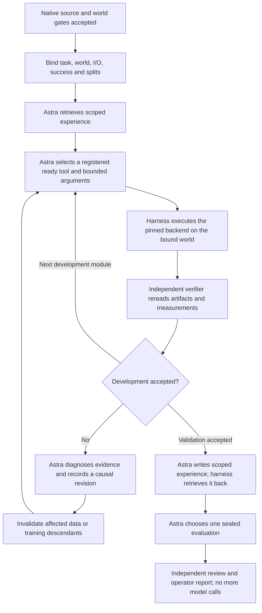

# Actual Astra decisions over the unified harness

`python -m astra_e2e.harness.agent --config <agent.json>` runs the policy-development
part of the unified harness after the accepted native world has been bound. It
uses the existing `CampaignLedger` and actual `gpt-6-astra` transport. The runner
does not select a manipulation algorithm on behalf of the model, emulate Astra,
or infer a semantic pass from a successful process exit.

The frontend remains the native proposal/check/review/freeze workflow. The
handoff is an immutable `world_bind` artifact; registration of a backend alone
does not establish that it executes the bound world.



## Method choice and evidence

Each registered backend declares executable operations and their implemented
methods. The model receives opaque backend handles, method names, argument
schemas, the declared task and I/O, compact development evidence and scoped
experience. For example, a qualified adapter may offer separate servo and MPC
collectors and separate ridge and MLP learners. ACT, DP, RL, residual RL or a new
method can participate through the same operations when a compatible, qualified
adapter exists. Listing a method in the historical library does not make it an
executable tool for a newly reconstructed scene.

Public planning facts include training, development and sealed-confirmation case
counts, never their seeds or identities. For collectors exposing
`episodes_per_case`, the requested total is the training case count times that
parameter. Repetitions do not add contract split groups or seed identities;
whether they sample different physical initial conditions depends on the adapter.
The minimum accepted episode requirement is a total number of successful demonstrations.
The model also sees the per-command timeout when choosing collection size.

Astra first chooses `retrieve`, optionally with exact context filters. Empty
context searches across tasks. It then chooses collection, training, development
evaluation, evidence review, diagnosis and revision tools as those tools become
ready. Failed evidence is retained. Revision requires the model's diagnosis,
transfer hypothesis, expected benefit, anti-hack analysis and ablation plan;
the controller invalidates affected descendants. The runner cannot modify the
frozen success definition, native world or evaluation splits.

The independent review hook receives the binding and worker receipt. It must
return evidence-backed `checks`, `failures` and optional `diagnostics`; unsupported
obligations fail instead of becoming automatic passes. `bound_native_review`
rechecks numerical I/O, labels, checkpoint lineage, case coverage and measured
success. Operator-authored native semantic qualification remains a separate
upstream obligation: hashes and numerical checks do not prove a scene looks or
behaves like the source.

## Frozen runner configuration

Create the binding, registered backend packages and reviewer input hashes using
the existing harness before launching the runner. All paths below are operator
paths on the worker. They are never exposed as executable model instructions.

For the qualified native vector adapter, the generic preparer can register the
available collectors, both dense learners and their common evaluator together:

```bash
python end_to_end/unified/prepare_unified_campaign.py \
  --binding /worker/run/binding.json --native-config /worker/run/native.json \
  --harness-root /worker/shared-harness --output /worker/run/campaign \
  --campaign native-stage-001 --native-python /runtime/isaac/python \
  --training-python /runtime/training/python --max-model-calls 40
```

The helper executes no policy job and grants no qualification. It rejects a
native success predicate that differs from the bound task contract. It pins all
shared `real2sim/src/calibrated_scene_reconstruction/**/*.py` code and the referenced factory, worker, trainer,
reviewer, transport and native configuration. Changing a shared simulation or
controller implementation therefore invalidates old registrations. A frozen
experiment uses an isolated code revision; upgrades require new registrations
and the harness's separate regression/promotion process.

Before starting the model or relay, run the mandatory exact-runtime preflight:

```bash
python -m astra_e2e.harness.preflight \
  --config /worker/run/campaign/agent.json --timeout-seconds 60
```

Registration remains a non-executing API and marks runtime readiness pending.
Preflight uses each registered worker's actual Python executable or launcher,
flags, working directory and worker environment. It imports the worker module
(`bound_native` or `bound_training` for the prepared dense tools) and verifies
the exact world binding. It does not initialize a simulation application, train,
collect data, call a model or install packages. New immutable reports retain the
argv, public environment identity, exit code, timeout and output hashes. Missing
packages, launcher errors, stale registrations and timeouts block production
runner startup before a model call. Dependency provisioning is a separate
operator/tool action; a data revision alone does not install missing packages.
After provisioning, rerun preflight and retain the earlier failed report.

The report proves readiness when checked, not immutability of an externally
managed Python environment. Re-run it after any runtime/environment change.

```json
{
  "schema": "astra_unified_agent_v1",
  "campaign": "native-stage-development-001",
  "binding": "/worker/run/binding.json",
  "state": "/worker/run/astra",
  "harness_state": "/worker/shared-harness",
  "learning_root": "/worker/repository/policy_development",
  "execution_mode": "production",
  "decision_transport": "authenticated_relay",
  "max_model_calls": 40,
  "runtime_preflight": {"directory": "/worker/run/campaign/runtime_preflight"},
  "backends": [
    {
      "path": "/worker/shared-harness/backends/collector/package.json",
      "parameter_schemas": {
        "collect": {
          "type": "object",
          "properties": {"episodes_per_case": {"type": "integer", "minimum": 1, "maximum": 16}},
          "additionalProperties": false
        }
      }
    },
    {"path": "/worker/shared-harness/backends/learner/package.json"},
    {"path": "/worker/shared-harness/backends/evaluator/package.json"}
  ],
  "reviewer": {
    "factory": "bound_native_review:review",
    "inputs": {
      "/worker/repository/policy_development/bound_native_review.py": "<sha256>",
      "/worker/repository/policy_development/bound_native.py": "<sha256>",
      "/worker/repository/policy_development/bound_training.py": "<sha256>"
    }
  }
}
```

Register separate packages for alternative methods. Add only parameters the
worker actually implements; an omitted parameter schema permits `{}` only.
Training hyperparameters may be exposed with explicit bounds. Evaluation exposes
no case, seed, checkpoint or success-threshold override. The shared harness state
retains the work library across campaigns. Optional `policy_query` adds a fixed,
read-only search of the legacy policy library; historical evidence keeps its
original scope and must be revalidated for the new world.

The intake, rather than the runner, sets `validation_scope`. Under an explicitly
authorized `simulation_verification` scope, simulator-only observation channels
can be disclosed and exercised. Reports and work-library entries retain this
scope. A pregrasp insertion stage does not establish grasp acquisition, a vision
policy, transfer readiness, or full-task real-robot success. The `deployment`
profile keeps the stricter availability requirements. Real validation remains
pending in either case; hardware is not reachable through this runner.

## Local client and remote worker

Set `decision_transport` to `local_codex` when the worker already has a supported,
authenticated Codex executable on its `PATH`. Otherwise keep authentication on
the existing client and run the optional SSH decision relay there:

```powershell
$env:PYTHONPATH = Join-Path $PWD 'src'
python end_to_end/unified/astra_unified_relay.py `
  --host user@worker `
  --remote-state /worker/run/astra `
  --state outputs/local-decision-relay `
  --max-model-calls 40 --wall-seconds 14400
```

On the worker, launch the execution runner with its intended Python environment:

```bash
python -m astra_e2e.harness.agent --config /worker/run/agent.json
```

The relay transfers only structured decision requests and audited responses via
SSH. Native source assets, datasets, checkpoint files, raw rollout traces and
sealed cases remain on the worker. No credentials are copied. The local client
uses the same real Astra invocation with direct shell, browser and other model
tools disabled; selected worker tools are executed by the remote harness. Each
response is bound to its exact request hash, and immutable ledgers prevent a
completed decision from being repeated after a reconnect. An authentication or
model failure yields an unmet report, never an offline substitute.

For a jump-host setup with an existing command transport, replace `--host` with
`--transport-prefix-json`, a JSON argv array ending in `--command`. For example,
`["python", "/client/remote.py", "source", "--command"]` appends one bounded,
quoted remote command to that helper. Existing helper files are pinned in the
relay's local configuration. Both transports use the same public decision spool;
neither uploads credentials or obtains arbitrary model-selected file paths.

## Completion, reuse and limits

The runner archives development-only experience and verifies that it can be
retrieved with its declared task, backend, I/O and scope before exposing the
sealed evaluation tool. Entries are procedural **candidates**, not globally
validated tools. The existing library's transfer-validation rules still apply.
Shared-tool promotion and rollback remain separate harness release operations;
this runner does not silently upgrade backend code during a frozen experiment.

After final evaluation starts, no outcome or trace is sent to another model
call. The operator receives `report.json`, the hash-linked decision history,
tool-request ledger, reviewer artifacts and Astra token/transport audit. A final
failure is retained and closes this experiment. Model calls, module attempts,
job count and wall time have finite limits. Budget exhaustion, missing tools or
unsupported review obligations remain unmet, even if some jobs succeeded.

Use the `progress_snapshot` harness tool for concurrent monitoring. It reads the
last completed hash-valid controller journal without taking the execution writer
lock, and reports recorded states only. It does not establish current source,
native-gate or acceptance validity. The authoritative `status` operation performs
those expensive checks under the writer lock and is not a progress poll.

The bound execution tool recognizes a typed writer-lock conflict before work is
reserved. It retries admission inside that same tool call, with a shared limit
of 40 retries and 10 seconds across preparation and execution admission, waiting
up to 0.25 seconds per retry. A prepared packet is reused. Hash-linked records in
`infrastructure_retries` preserve the budget, counts and outcomes; no additional
model decision is consumed. A newly reserved attempt, an active writer beyond
the finite budget, native/adapter errors and malformed receipts remain failures;
they are never silently rerun through this infrastructure mechanism.

`simulation_policy_accepted` means the contracted simulation policy stage passed
independent review. It is not the complete deployment handoff; packaging and real
validation remain separate. `offline_fixture` is available only through explicit
test callbacks and is rejected as a production substitute. CPU tests exercise
orchestration and evidence flow; native physics and real-model results require
their own retained execution evidence.
# Restored-world intake and frontend adoption

`end_to_end/unified/prepare_outer_campaign.py` prepares a candidate outer contract
from actual `native_config.policy_io` and `success_rule`, plus an explicitly authored
source/task/fidelity context. It does not initialize the controller or run physics,
collection, training, evaluation or an LLM. Its proposed verification protocol uses
32 training, 8 development and 16 sealed confirmation initializations, at least 24
successful demonstrations, a 0.75 success-rate target, four feedback cycles, four
attempts per module, 30 total jobs, four hours and 40 model decisions. Final scope
and configuration must be reviewed before activation.

```
python end_to_end/unified/prepare_outer_campaign.py draft \
  --native-config /absolute/native_config.json \
  --context /absolute/context.json --output /absolute/new_candidate
```

The context supplies exactly `name`, `objective`, `source`, `task`, `fidelity`,
`variation`, `allowed_workdirs`, `gpu_ids`, `memory_gb` and `assumptions`, using the
outer intake schema for nested fields. It must describe initialized grasps,
fixtures, privileged observations and unresolved real-world transfer explicitly.
For a single-scene verification, split groups denote disjoint initial-condition
draws; they do not establish independent-scene generalization. Seeds remain on
the worker and are never included in the model-facing catalog.

The generated `semantic_review.template.json` contains every required semantic
check with a **false, pending** value. An independent reviewer copies and fills it
with their identity, scoped rationale and exact evidence-file hashes. Hashes only
identify the inspected material. They cannot establish geometry, material or task
semantics. The evidence manifest separately identifies approved parent/current
mesh pairs, completed native intrinsic reports and an actual robot release probe.
The helper independently:

- measures corresponding-vertex displacement and checks topology; the quantity
  means restoration preservation, not absolute real reconstruction accuracy;
- replays native pose, penetration, contact-count and force/torque recordings,
  including zero-force release and all declared numerical physical priors;
- re-scores native robot probe traces with the exact configuration predicates,
  requiring a negative attached start and at least two distinct successful free
  releases in one probe run, so a one-off success cannot hide a broken reset;
- checks actual code/source/robot asset provenance and native physics diagnostics;
- recomputes native stages and verifies the existing independent freeze.

Missing evidence, unsupported checks or failed semantic reviews stop activation.
Native robot configurations list `runtime_asset_files`, including the robot spec
and USD dependency closure (a conservative package superset is allowed). Runtime
metadata records which external inputs were actually used. These current hashes
enter the frontend binding and every registered backend; editing a referenced
robot layer invalidates the old registration just as editing runtime code does.
The helper cannot write a native gate review or manufacture a freeze. Once all
evidence is complete, the explicit `advance` command uses real controller packets
and reviews in dependency order: research, capture, model, physics, environment,
twin. These packets **re-verify adoption** of existing artifacts; they do not claim
to rerun reconstruction. Only then is a world binding exported for the separate
`prepare_unified_campaign.py` tool registration step. The wall budget begins at
this explicit activation, and the six frontend checks count toward the job budget.

```
python end_to_end/unified/prepare_outer_campaign.py advance \
  --candidate /absolute/new_candidate/candidate.json \
  --semantic /absolute/reviewed_semantics.json \
  --evidence /absolute/completed_native_evidence.json \
  --run /absolute/new_outer_run --binding /absolute/new_binding.json \
  --task-id reviewed_task_identity --python /absolute/worker/python
```

Configuration changes require a new candidate and corresponding qualification
review before activation. A passed frontend is not a learned policy, hardware
qualification or proof of real-world transfer. No hardware path is enabled.

## Explicit continuation and recovery

A completed, unmet development campaign can receive a separately named finite
model-call grant through `astra_e2e.harness.continuation.prepare`. The helper
only creates a descriptor; it does not execute a model or a tool. Set that
descriptor as the new configuration's `continuation`, use a new campaign/state
directory, and set `max_model_calls` to the declared additional grant. The reason
must identify the operator's decision under the ongoing user request. Additional
calls are never described as having fit inside the original grant.

Parent reports, configurations, implementation maps and complete hash-linked
histories are pinned and verified, including earlier operator handoffs. A parent
must be finished with no pending tool, under the same world binding and execution
mode. Any sealed-evaluation attempt forbids a new development continuation. The
existing outer run retains its wall-clock, job, attempt and revision budgets.
Reports count prior model reservations separately from the new grant and their
cumulative total; an interrupted child retains its original cost snapshot.

Receipt, review, failure diagnostics, retrieval and memory state are restored.
Exact current module attempts, request hashes and dependency acceptances must
match. Unexplained external progress fails closed and requires an explicit
evidence handoff. Explicit invalidation clears obsolete acceptance while keeping
the prior exception and latest causal feedback visible. Current accepted
development may proceed to memory or sealed confirmation without rerunning data
or training. Repeated retrieval reports whether evidence changed, and after
three consecutive reads the agent must choose another available action or stop;
the runner does not choose a learning method for it.

`end_to_end/control_plane.py` supports an externally pinned control plane for
an otherwise frozen worker checkout. Its configuration pins the exact bootstrap
and `agent.py`, `preflight.py`, and `continuation.py` overlay bytes. Only those
three controller modules are replaced in-process; other imports remain under
the frozen source root. Worker environments and native subprocess code are
unchanged. Run mandatory exact-runtime preflight through this bootstrap before
starting the additional campaign. CPU continuation/bootstrap tests validate this
orchestration contract, not native physics or autonomous policy success.
