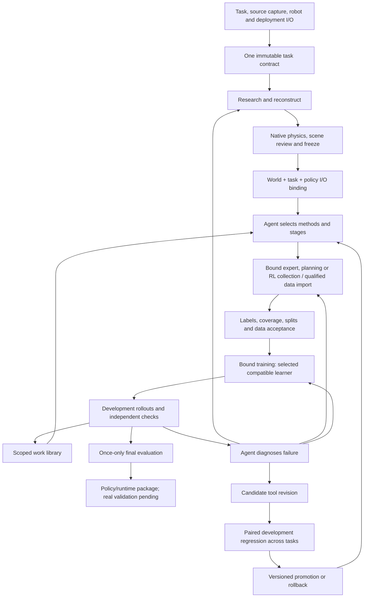

# Unified agent-orchestrated real2sim2real harness

Use the [chain tools](reconstruction.md) for observation-driven reconstruction and station handover.

Use an optional external learning-tool service for inspection via `--learning-root`. The built-in station and world-bound methods are available independently.

The reasoning agent chooses methods and diagnoses failures. The harness makes
those choices executable and reviewable: it controls dependencies, binds the
actual scene and policy interfaces, preserves failed attempts, separates
development from final evaluation, and versions reusable tools. Native scene
quality, model reasoning, CPU interface checks, simulated task performance and
real performance remain different claims.

For actual Astra method selection, use the bounded
[Astra runner](astra_runner.md). It calls the authenticated model, supervises
registered workers, invokes a pinned evidence reviewer, and records decisions
and failed attempts. The JSON service below remains usable independently.

Contracts default to `validation_scope: "deployment"` and require every policy
channel to be available on the robot. An explicitly scoped
`validation_scope: "simulation_verification"` may declare privileged simulator
observations with `available_on_robot: false`. This changes the completion claim
to simulation pipeline verification with deployment I/O qualification pending;
it does not relax native scene, physical contact, data integrity, success or
sealed evaluation requirements. A pregrasp insertion test must also disclose its
initialized grasp, fixture release and action interface in the task contract.



## One entry point, two preserved execution layers

Run from the source checkout with the intended environment; do not change a
shared editable install:

```sh
source env.sh          # repository root: puts the three source roots on PYTHONPATH
python -m astra_e2e.harness schemas
python -m astra_e2e.harness serve --state "$PWD/outputs/harness/site" --execute
```

The process accepts one JSON request per line and writes one JSON response per
line. `--execute` permits contracted simulation commands; the intake still
controls work directories, GPU allocation, job and wall-clock limits. Without
it, policy jobs are prepared without launching the worker. This is an agent tool
transport, not an MCP server or an embedded LLM. Astra, another external agent,
or an operator can use exactly the same tools. The service is not a shell security
sandbox; registered adapter code and reviewed work packets remain trusted code.

```json
{"operation":"list_tools"}
{"id":"methods-001","name":"learning_catalog","arguments":{}}
{"id":"backends-001","name":"backend_catalog","arguments":{"task_id":"my_task"}}
```

The service persists request IDs in SQLite. Reusing an ID with different
arguments or execution authority fails. Replaying a completed or failed request
does not rerun its command. An interrupted reservation stays reserved; inspect
the owning module and use explicit recovery. Read-only qualification/status
requests revalidate current evidence while retaining the original response in
the ledger. Use a new request ID for a genuinely new experiment.

The frontend owns source reconstruction, native gates and the outer module
graph. The learning package retains ACT, DP, RL, residual RL, MPC, BC and other
method adapters, reward decisions, task-specific workers, stages and work
library tools. Their existence is not a claim that each method is executable
for every task. `learning_catalog`, `learning_inspect` and `learning_prepare`
expose actual capabilities and blockers. The new path executes a tool only
through a registered adapter that consumes the current world binding.

## End-to-end operation

1. **Contract:** call `intake`, `plan`, then `init` with a resolved source/task
   contract. Reuse the user's existing authority. Preserve actual success,
   observation/action semantics, timing and disjoint splits. The existing
   example intake is intentionally unresolved; it is not a runnable task.
2. **Construct and qualify:** use `next`, `run`, `review` and `feedback` for the
   native modules. Commands finishing successfully do not automatically accept
   a scene. Existing S0–S6, native contact, object/source reviews and independent
   freeze checks are unchanged.
3. **Bind:** `world_bind` writes an immutable worker artifact containing the
   accepted native session, all relevant upstream evidence, task/backend identity,
   exact policy I/O, success and split contracts. Agent responses omit final
   evaluation seeds. `world_verify` recomputes native acceptance and checks the
   binding is still current; a path to a USD is insufficient.
4. **Choose tools:** use `experience_recall`, `learning_inspect` and
   `backend_catalog`. Select a compatible collector and learner, or implement a
   missing adapter behind the same contract. Do not silently substitute a
   historical Peg scene, a different robot or a different task definition.
5. **Execute:** `policy_execute` selects a registered operation (`collect`,
   `import_data`, `train`, `develop`, or `confirm`). It writes a unique job request
   and supervised module packet, pins adapter code/configuration, and uses the
   outer controller's authority and budgets. Method parameters cannot override
   task, world, success or split identity.
6. **Review:** inspect the actual data, images, motion, logs and artifacts. Submit
   `policy_report` with the worker receipt, exact artifact paths and evidence-
   backed checks. Translation verifies labels, split coverage, I/O, checkpoint
   and current-attempt identity. `review` accepts or rejects development reports.
   Final reports are retained for the operator and submitted by `policy_review`
   without returning individual final cases to the planning agent.
7. **Iterate:** classify the failure and issue `feedback`. Data/label problems
   return to collection; optimization/reward/controller problems return to
   training; source/geometry/physics problems return to the appropriate frontend
   module under a transfer hypothesis. Changing upstream evidence invalidates
   descendants. A frozen scene needs a derivative session and a new experiment.
8. **Remember and deliver:** store scoped development findings and failures;
   retrieve them with applicability constraints on later tasks. Package accepted
   policy, preprocessing, controller, sources and evaluation lineage. Keep real
   validation pending; no hardware operation is provided by this integration.

## Executable backend contract

`backend_register` accepts an `astra_bound_backend_v1` manifest. Each operation
declares a method name and an argv array, working directory, environment, pinned
implementation/configuration inputs and finite timeout. The argv must include
the separate `{binding}`, `{request}` and `{result}` arguments. Substitution uses
argv elements, never shell concatenation. Example shape:

```json
{
  "schema": "astra_bound_backend_v1",
  "id": "my_robot_task_v1",
  "task_id": "my_task",
  "backend_id": "my_native_backend",
  "simulation_only": true,
  "operations": {
    "collect": {
      "method": "mpc",
      "argv": ["/absolute/python", "/absolute/adapter.py", "--binding", "{binding}", "--request", "{request}", "--result", "{result}"],
      "cwd": "/absolute/checkout",
      "env": {},
      "inputs": ["/absolute/adapter.py", "/absolute/task-config.json"],
      "timeout_seconds": 600
    }
  }
}
```

Paths above are schematic, not a supplied MPC implementation. Registration
checks immutable code identity and interface shape; native compatibility still
requires actual execution and independent evidence. An adapter must load the
bound scene and implement its declared robot/task interface. It must not decorate
an old result with a new binding hash.

The job request includes operation, module, selected method, parameters,
accepted predecessor evidence, binding hash, adapter hash and a unique job ID.
The backend writes `{receipt, artifact_paths}` to the requested result file.
The receipt follows `astra_bound_policy_receipt_v1`, with exactly `schema`,
`status`, `operation`, `facts`, and `artifacts`. This is distinct from the retained
legacy `astra_repair_receipt_v1` protocol with grant, reservation and cost fields.
The new receipt uses its supervised oversight attempt for execution authority and
budgets. Its `facts.oversight` identifies:

```text
binding_sha256, task_id, backend_id, module, request_sha256,
policy_io_ref, dataset_manifest_ref, checkpoint_ref, evaluation_ref
```

Each non-null reference must resolve to an immutable artifact in that receipt.
`request_sha256` binds the actual unique job request pinned by the current
module attempt. A receipt from an earlier attempt, even in the same unchanged
world, cannot satisfy a later attempt. Evaluation uses the exact training
checkpoint and all contracted cases, including failures. Generic numeric BC
training is provided by `end_to_end/unified/bound_training.py`; its narrow vector
observation/action contract is distinct from image-based ACT or DP.

Different stages may select different families. The integrated
`end_to_end/unified/stage_graph.py` retains explicit entry/exit signals, stage
policies, action bounds and state reset on handover. A tissue or bottle task still
needs qualified mechanism, stage-transition and policy adapters; the generic
outer workflow never treats an example graph as a completed task.

## Improvement and reuse

There are two feedback timescales. Within a fixed world and task contract, the
agent changes data, rewards, policies or stages using development evidence. At
the tool level, it registers a new immutable implementation and compares it on
multiple tasks before promoting a shared release. Rollback changes the active
tool version; it does not rewrite old datasets, checkpoints or results.

Use `release_promote` with the new backend packages and paired baseline/candidate
development runs for at least two different tasks. Both runs must retain current
accepted validation, the same source/frozen world, task, policy I/O and evaluation
cases. Every stratum must meet its task gate and must not lose successes relative
to the baseline. Upgrading an existing release retains every previously covered
task and compares against its active backend version. Promotion happens before
final evaluation and does not use final outcomes. `release_status` returns active
backend paths with current evidence status; `release_rollback` restores the
previous still-valid release, retaining immutable version and event history.
This is measured nonregression on the supplied development cases, not proof of
universal improvement or statistical superiority.

Keep each executable source version in a separate immutable directory or Git
worktree before registration. Registration pins code; it does not make a hidden
copy of arbitrary dependencies. Editing an old source path invalidates its
package and dependent evidence, and cannot be undone merely by selecting its
old hash. Rollback therefore requires the previous version's retained source,
configuration and regression artifacts. The agent must create a new version
when evolving a tool and preserve the old one.

The preserved learning library distinguishes reusable exact matches from
adaptation candidates and inspiration. Frontend procedural memory keeps source
fits separate from transferable procedures. Unified recall returns both scopes
explicitly instead of silently combining their qualification meanings. No model
weights are updated by writing an experience record.
