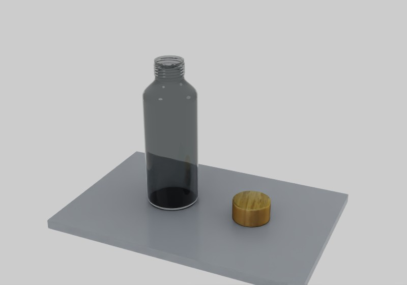
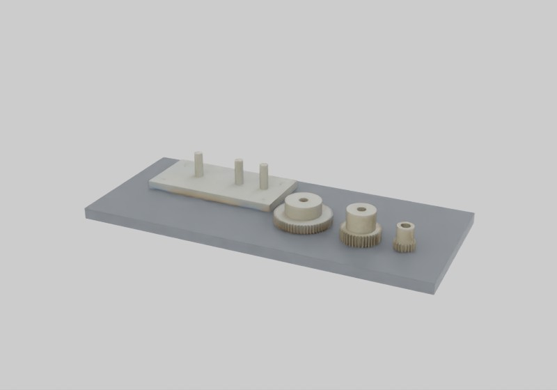
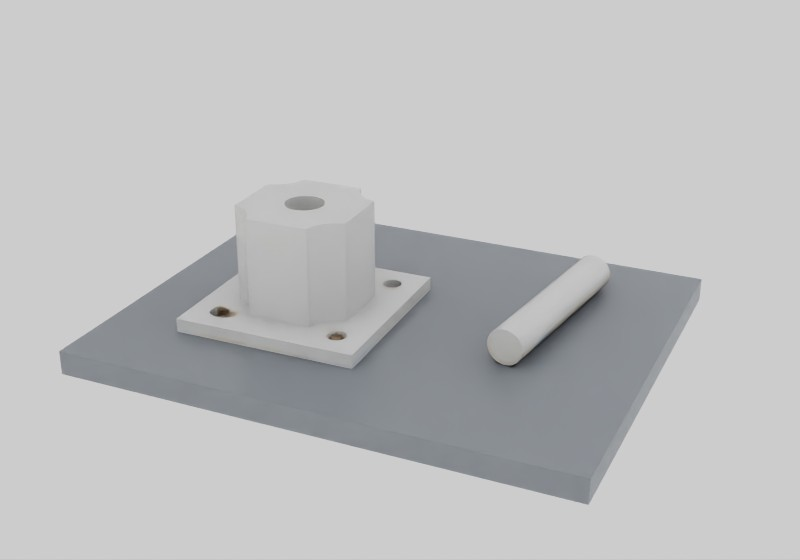
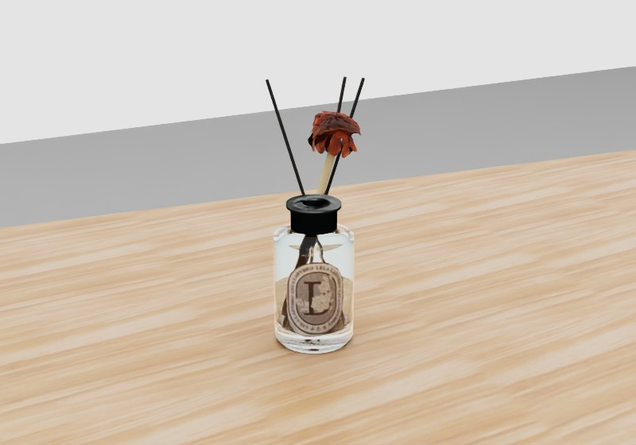
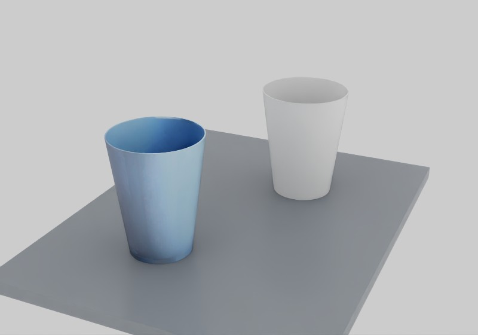

# Reconstructed assets

Open a USDZ directly in Isaac Sim 5.1. Select `/World/Camera` for the pictured view. The interactive scenes open in their initial poses. Press Play to start physics and use a manipulator or controller for the task.

Each package contains the task objects and their support. The reed diffuser retains the calibration table and floor. The threaded bottle retains its table collision geometry. The peg, gears and cups use simple platforms. All five examples can be operated with your own controller. For the glass appearance in the previews, the reed diffuser uses NVIDIA's OmniSurface material and the threaded bottle also uses OmniGlass. Other USD viewers need compatible MDL support to reproduce those materials.

| Threaded water bottle | Three-gear train |
|---|---|
|  |  |
| [Open USDZ](assets/threaded-water-bottle.usdz). Hold the bottle upright, align the cap, and turn it. The mating surfaces guide axial travel. The water uses PhysX particles and an isosurface. Use GPU dynamics for this scene. | [Open USDZ](assets/gear-train.usdz). Seat the large, medium and small gears on the matching posts. Hold the base and drive just the large gear. Tooth contact transmits rotation through the other two. |
| **Peg and socket** | **Reed diffuser** |
|  |  |
| [Open USDZ](assets/peg-in-hole.usdz). Orient the peg along the bore, center it above the opening, and release it. The hidden cavity floor is inferred. | [Open USDZ](assets/reed-diffuser.usdz). Push the glass vessel with the flower and all three reeds in place. The reeds and flower stem move independently through contact. The petals use particle cloth attached to the flower. Use GPU dynamics. |

### Nesting cups

Center the blue cup over the white cup and release it. Both cups have hollow collision geometry. [Open USDZ](assets/nesting-cups.usdz).

To build from your own capture, follow the [reconstruction workflow](../end_to_end/docs/reconstruction.md).

## Asset credits

The Real2Worlds2Real team created the models, textures and rendered previews. The team has permission to distribute the product-label artwork visible on the diffuser with these examples.
