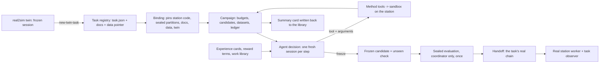

# Station path of the Astra harness (policy development)

The station path runs Astra policy development on a **station**: a simulation of one task that serves the robot's own
interface (what the real robot observes, what it accepts), applies the real robot's safety limits, hides its success
judge and seals its evaluation starts. A station is either a hand-authored simulation
task or a **frozen real2sim twin** of this repository. The reconstruction-bound path in
[unified_harness.md](../../end_to_end/docs/unified_harness.md) remains for its own jobs.

Module map: [policy_development/README.md](../../policy_development/README.md). Task-specific code (task specs and
documents, Isaac task backends, real-robot chains, comparison campaigns) lives in a task directory that the operator
supplies; none ships with this release.



## What is generic and what a task supplies

Nothing in this repository names a task. A task supplies, in the task directory's `tasks/<task>/`:

- `task.json` (`astra_station_task_v1`): text, documents (`doc`, `station_doc`), demonstrations (`data`, usually
  `station:task_data/<task>` in the station root), `policy_io` (interface, action size, rate, length, deliverable kinds),
  retrieval `tags` (scene, objects, phases, robot), point-cloud `labels`, `real_constraints` (verified real-robot lessons
  shown to the agent), and two blocks:
  - `station`: `partition_kind` (its sealed partition file), `backend` (`<file.py>:<Class>`), `runtime`, `num_envs`,
    `need_mb`, allowed `hosts`, `env`, backend `args`, optional `kinematics_model` (identified arm parameters, used to run
    programs behind the policy interface) and `heldout_progress` (graded judge values reported beside success);
  - `real`: `worker_cost` (the real worker's per-step budget and CPU fk / ik cost: programs are measured against it and
    the agent is told) and `handoff` (a deliverable `registry` the real worker reads, or a package `builder`).
- the backend (`station_backends/<kind>.py`) and, for real-robot work, its real chain (`real/<task>/`).

Interfaces (`policy_io.interface`): `cloud_q29` (labelled cloud, q29, palm pose, tactile; 29 absolute joint targets; hold =
measured joints) and `state_vector` (an observation vector with a named layout; delta actions; hold = zeros). The station
also states them at run time (`info["interface"]`, `info["hold"]`, `info["kinematics"]`); the evaluation runner, the
rollouts and the real worker take the hold rule and the program contract from there (`station/client/program_runtime.py`).

## Methods (tools)

| Tool | Family | Interfaces | What it does |
|---|---|---|---|
| `evaluate` | evaluation | all | A candidate on the 15 open development starts (paired across candidates) or N training starts; per-start outcomes, task-independent diagnostics; for programs on training starts also `real_time` (estimated per-step compute on the real worker). |
| `import_real` | data | cloud_q29 | Real demonstrations cut to a segment by observation predicates, optional hold frames. |
| `record_demos` | data | cloud_q29 | Successful station episodes of any candidate in the real demonstrations' format. |
| `train_act` | imitation | cloud_q29 | The lab's point-cloud ACT on any weighted mix of datasets. |
| `synthesize_program` | program | all | A confined program-synthesis session (ASPIRE fix-loop discipline) driven by Astra's brief and the selected experience. |
| `research_session` | rl | all | A confined auto-research session (ENPIRE contract): RL on the station, learning from data, post-training candidates, or code. |
| `train_residual` | rl | cloud_q29 | Residual RL post-training (bounded incremental palm / joint offset, TD3) of any base, reward from library terms. |
| `compose` | composition | cloud_q29 | Stage chaining of two candidates with an observation switch. |

`train_act` drives a trainer that is **not part of this repository** (the lab's point-cloud ACT training code). It is
offered only at a site that names both compute entries it uses; elsewhere it is loaded as unavailable. The contract:

| Site entry | What the adapter does with it |
|---|---|
| `compute.act_train` | `ssh` host, `jobs_root`, `python`: copies the datasets there and runs `runtime/act_prep.py` (prepared arrays and `normalization.pth` under `{prep}`); then runs `train` (argv with `{prep}`, `{out}`, `{seed}`, `{epochs}`; `env` added), waiting until `gpu_free_cmd` reports `need_free_mb`. The trainer must leave `{out}/policy_best.pt`, `{out}/policy_last.pt` (torch checkpoints with a `metadata` dict) and `{out}/train_summary.json`. |
| `compute.act_runtime` | `pkg`: the model code each candidate carries (`point_act_cvae.py`; `il/act_policy.py`, `il/point_features.py`, `il/pointnext_encoder.py`, `il/pointnet2_batch/`); `libstdcxx` (optional): the libstdc++ its compiled point ops need, preloaded by the candidate before torch. |
| host: `retrieve`, `reward_search`, `remember`, `freeze`, `stop` | | | Library search, experience write-back, hand-over (then the unseen check), end. |

Every candidate is a station deliverable (policy module or program). Programs run in every context through one
implementation of the program contract (`program_runtime.py`): the sealed evaluation, rollouts, the policy interface
(with the task's identified arm model) and the real worker (its real-time variant: a late program holds, the newest
action and observation win).

Libraries: experience cards and reward terms (`policy_development/library/`), the reviewed work library (~200 literature
and lab rewards, `library/work_library.py`, read-only). Retrieval ranks cards by tag overlap with the task.

## Agent neutrality

`transport.py` defines one decision interface: `decide(prompt) -> (decision, audit)`: `claude_cli`, `codex_cli`,
`command` (any agent behind a command) and `fixture` (tests); worker sessions use the same families. Audits record which
model answered.

## real2sim twins as stations

```sh
# from the delivery record either real2sim route writes (real2sim-harness deliver)
python -m astra_station new-twin-task --delivery <name>.delivery.json --task-id <id> \
    --factory <file.py>:<function> --policy-io '{"observation": [...], "action_dim": 4, "action": "...", "interface": "state_vector"}' \
    [--setup <setup.json>] --num-envs 1 --out <task registry>/<id>
# or directly from a frozen scene-pipeline session
python -m calibrated_scene_reconstruction.scene.twin.freeze real2sim/sessions/<name>
python -m astra_station new-twin-task --session real2sim/sessions/<name> --config real2sim/configs/<name> --task-id <id> \
    --factory <file.py>:<function> --policy-io '{...}' --out <task registry>/<id>
# coordinator, once per station root and task
python policy_development/station/server/partitions.py <station root>/sim/sealed/<id>_partitions.json
python -c "import secrets; print(secrets.token_hex(32))" > <station root>/sim/sealed/heldout_token   # if the root has none; chmod 600
```

The station is `station/server/twin.py:TwinStation`. From a delivery record it re-hashes every pinned file before it
starts, and the binding pins the record and those files: a campaign runs only on the twin that was accepted. A
scene-pipeline spec takes its tags from the twin's task contract (`configs/<name>/task.json`, `scene_graph.json` task
kind -> phases). A task-workspace record states neither a task kind nor a robot placement; `--setup` carries the station
author's declaration for the factory and is kept in the spec as theirs (`twin.setup`, `twin.setup_source`).

The environment factory builds one environment per station env and follows the protocol in `twin.py` (`reset(case)`,
`observe()`, `step(action)`, `measure()` with the hidden `success`). It is written per task, with the twin:
[`real2sim/examples/station/`](../../real2sim/examples/station/README.md) has a worked factory for each route, both
started as real stations in Isaac Sim 5.1.

## Running

```sh
source env.sh          # repository root: puts the three source roots on PYTHONPATH
python -m astra_station bind --site policy_development/configs/station/site.example.json --task cup_lift --out <dir>/binding.json
python -m astra_station init --binding <dir>/binding.json --campaign <campaign> --run r1
python -m astra_station prompt --state <state dir>        # inspect the first decision prompt (no model call)
python -m astra_station run --state <state dir>           # the decision loop (until freeze or budget end)
python -m astra_station heldout --state <state dir>       # coordinator: sealed evaluation, once
python -m astra_station handoff --state <state dir>       # operator: hand the frozen deliverable to the task's real chain
```

Default budget: 2000 training episodes, 20 development evaluations, 10 wall-clock hours,
12 GPU hours, 40 decisions; per-method caps (ACT trainings 4, residual runs 2, program sessions 3, research sessions 2).

Station root: the arena (`~/astra_real_arena`) is an installed instance of `policy_development/station/` (client,
server, coordinator), `policy_development/real_robot/` and the task directory; `policy_development/station/install.py --check`
compares it with both sources, `--apply` installs (refusing to replace files that unfinished campaigns pin).
`research_session` hands the session the ENPIRE baseline's own instruction file, which is not part of this repository:
put a checkout of ENPIRE at `<station root>/third_party/ENPIRE` (the tool needs
`enpire/policy/autoresearch_instruction.md`); without it the tool is listed as unavailable and campaigns run without it.

The coordinator uses the virtual environment at `<station_root>/.venv` by default. Set `venv` in the site JSON for another environment. An editable LeRobot checkout needs its directory in `lerobot_src`; an installation in the environment uses the installed package. `uv_python` can specify a separate interpreter cache. Set `TT_HELDOUT_HOSTS` to a comma-separated list of configured host names to restrict held-out evaluations.
