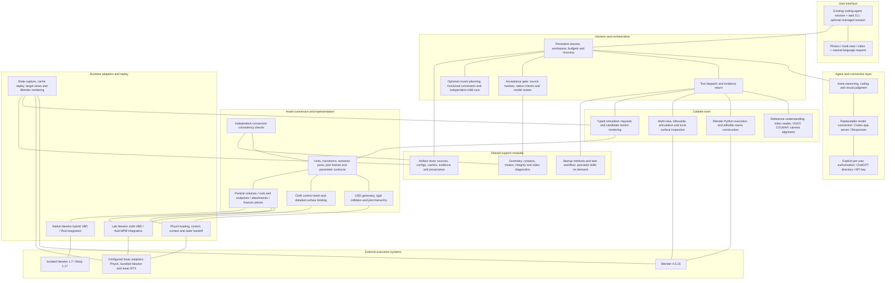

# Real2Sim Harness and Calibrated Scene Reconstruction

Part 1 of the repository: from photos or video of a real scene to simulation assets a robot can use. An agent (ASTRA)
reads layered skills, selects tools as the task needs them, inspects what they return and revises its own work until
the result matches the source and behaves correctly in the target simulator.

```text
Real-world observations (static photos, a walk-around video, a motion video) + the request in words
  -> ASTRA reads skills: core principles -> task workflow -> specialist skills
  -> tools selected as needed: segmentation, COLMAP, VGGT, Blender, camera pose, mesh fitting, texture baking,
     Gaussian splats, PhysX, Newton, contact tests, motion checks
  -> numerical and visual feedback to the same agent -> repair and retest -> accept
  -> experience distilled into personal skills for the next task
```

| Workflow | What is delivered |
|---|---|
| **Digital twin** | Analysis and separation of the scene, each object modelled as editable Blender/Python code and refined against the views, functional tests in simulation (contacts, joints, mating parts), and the scene itself: surface and scale, layout, lighting and a robot interaction setup |
| **Digital cousins** | Variants that keep what matters: the invariants are identified first (joints, supports, containment), then objects and scenes are varied in form, layout and style, each variant verified on its own |
| **Physics calibration** | Motion recovered from video, experiments designed and simulated with priors, simulated and real motion compared and the parameters refined |

[The skill index](skills/README.md) maps every skill and tool to these layers. The [agent module workflow](../end_to_end/docs/reconstruction.md) selects and combines operations from these native implementations:

- **Task workspaces** (`real2sim-harness task ...`): one object or a composed interactive scene, built and reviewed through
  JSON domain operations in the agent's own conversation. Described from [Start here](#start-here) on.
- **The scene pipeline** (`calibrated-scene-reconstruction ...`, `pipeline/twin.sh`): a walk-around video becomes a scene in metres
  with the robot placed, through seven reviewed gates. Described in
  [Metric scene twins](#metric-scene-twins-from-a-walk-around-video).

Run the commands of this part from this directory (`real2sim/`): configurations, sessions, environments and launchers
are addressed relative to it.

The bundled simulator adapters target **Isaac Sim 5.1 / Isaac Lab 2.3** through the PhysX compatibility profile; see
the [5.1 setup and supported routes](docs/ISAAC_SIM_51.md).

## Task workspaces: editable, operable objects and scenes

The agent harness generates editable, operable simulation objects from photos, multiple views, or video. Astra uses Blender/Python and optional specialist tools, inspects their results, and revises assets through a persistent coding session. Accepted twins can optionally seed functional cousins with new geometry, proportions and materials.

```text
Photos / video + user prompt
  → Astra ↔ Blender, renders, skills and optional reference tools
  → target simulation → numerical + visual feedback to the same Astra session
  → repair and retest when needed → accept a source-matched asset
  → optional functional cousins, each independently verified
```

This directory contains the reconstruction source, skills, runner configurations and setup instructions. Install the dependencies for your workflow and configure your own coding-agent session and simulator runtimes.

The harness, editable asset contracts and scene runner protocol are independent of a particular Isaac Sim/Lab release. Configure your own model authorization and simulator adapters. The versions below document a tested reference setup for the bundled adapters; they are not a framework-wide version lock. Other releases need compatible adapters and their own validation, rather than changes to the agent pipeline. See [backend configuration](docs/SCENES.md#simulator-adapter-protocol) and [environment reference](docs/ENVIRONMENTS.md).

Optional [posed-observation tools](docs/OBSERVATION_TOOLS.md) refine agent-authored geometry against multi-view masks, bake visible photo details into mesh UVs and recover support footprints under occlusion. Astra chooses when to use them; they are shared by object and scene generation, with retained inputs and numeric/visual feedback.

Assets retain editable physical parameters, replaceable backend interfaces and source-matched simulation evidence so collaborators can later add real-world dynamics alignment.

## Start here

Use a Linux workstation and Python **3.12**. Install **Blender 4.5.15 LTS** separately and make `blender` available on `PATH`, or pass its absolute executable path using `--blender`. Development currently uses an editable source checkout because scripts and skills are loaded relative to this checkout.

```bash
python3.12 -m venv .venv
source .venv/bin/activate
python -m pip install -e '.[vision,video,simulation,scene,fitting,dev]'
export REAL2SIM_ISAAC_PROFILE=5.1
real2sim-harness doctor --blender /path/to/blender
```

### Use your existing coding agent

Start Codex with Astra (or another compatible coding agent) in this checkout and give it your references and request:

```text
Read AGENTS.md and skills/use-real2sim/SKILL.md. Use the current conversation to
generate an editable, operable simulation object from my reference. Inspect and
revise it through the configured target simulator, then deliver the accepted
asset. Generate cousins afterward only if I request them.
```

The current agent owns reasoning, source/log/media inspection and optional native
subagents. Domain commands create independent tasks, run Blender and simulation,
and preserve source-matched acceptance. They start no model session and need no
repository-specific model login. Native permissions and model authorization
belong to the coding client; generated Blender execution retains its Linux task
boundary. Install simulator runtimes following [installation](docs/INSTALLATION.md).

```bash
real2sim-harness task init --reference /path/to/object.mp4 \
  --blender /path/to/blender \
  --objective 'Preserve the design and function, then generate two functional cousins.'
real2sim-harness task schemas --run /path/to/returned-run
real2sim-harness task schemas run_blender --run /path/to/returned-run
real2sim-harness task call /path/to/returned-run run_blender --request /path/to/request.json
```

Read the returned `external/context.json` and `external/startup.md`. Original
videos remain available without mandatory frame extraction; returned images and
movies are native file paths. Object work, scene participants and cousin variants
use the same domain services. Scene-child requests return a child task for the
current agent instead of launching another model. See the [external-agent skill](skills/use-real2sim/SKILL.md)
for task continuation, scene mode, cousin planning and final acceptance.

### Optional managed session

The existing managed entry remains available for operators who want the framework
to own model-session startup, tool responses and continuation. Install the
`chatgpt` or `api` extra, a compatible Codex CLI, and configure your own
[model authorization](docs/MODEL_CONNECTION.md). Model availability follows that
authorization; the model ID is configurable. Search is disabled by default.

```bash
# API-key example: set OPENAI_API_KEY in your own environment first.
real2sim-harness generate --reference /path/to/object.jpg \
  --blender /path/to/blender --auth api-key --model gpt-6-astra \
  --objective 'Create an editable simulation object preserving the visible design and function.'

# Explicit per-user ChatGPT authorization; never uses another user's saved account.
real2sim-harness generate --reference /path/to/object.mp4 \
  --blender /path/to/blender --auth chatgpt-plan \
  --auth-dir /path/to/your/private/real2sim-harness-auth --model gpt-6-astra
```

`--reference` can be repeated in both entries. In external sessions, `task cousins`
prepares post-twin planning and `task next` returns the next retained variant.
The managed entry also supports `--cousins N` and `--cousin-prompt`. Counts are
user-defined, and articulated connectivity is preserved while geometry may change.

[Whole-scene cousins](docs/SCENE_COUSINS.md) use the same optional stage after an accepted scene twin. Astra coordinates functional object redesign with all-mesh or optional Gaussian background changes. Layout is preserved by default; natural-language requests may also ask for layout variation. Each cousin requires fresh whole-scene acceptance. The linked document describes its controls and validation requirements.

## Metric scene twins from a walk-around video

The [bundled robot inventory](assets/robots/README.md) includes the Vega 1P assembly with both Sharpa hands and the standard Franka Panda. For optional grasp synthesis, supply the hand descriptor and related inputs under `SCENE_RECONSTRUCTION_ROBOT_ASSET_ROOT`. Tabletop optimization also requires a [compatible external solver](docs/robots/grasping.md).

The scene pipeline reconstructs the scene a robot will work in: the support surface, the task objects, the surroundings
and the robot itself, in one metric frame. Scale comes from legal evidence in the capture (a calibration board, or the
robot's known geometry), never from the task's true dimensions. Task objects are agent-authored Blender models fitted
to the views (the same idea as the object workflow above), and every stage ends in a review the agent must write after
looking at the evidence.

| Gate | Establishes |
|---|---|
| S0 capture | Key frames, the camera's self-calibration, camera poses of the walk |
| S1 scale and frame | The metre, the floor, the support's top; the robot's base and joints when it is in view |
| S2 task zone | The support's geometry; each task object's shape, size, place and colour (the object loop, OBJ) |
| S3 environment | The surroundings: a local zone, a completed mesh room or a Gaussian-splat background |
| S4 appearance | Materials, colours and lighting |
| S5 whole scene | No penetration, rest under physics, the task check, the twin against every frame from where it was filmed |
| S6 delivery | The tour video and one self-contained USDZ, opened alone in Isaac Sim; then the freeze |

```bash
calibrated-scene-reconstruction schemas                       # inspect the bundled JSON contracts in the host environment
pipeline/twin.sh --help                          # the stages in order for one session
calibrated-scene-reconstruction evolve recall outputs/real2sim_evolution /absolute/path/context.json   # experience that matches this task
real2sim-harness deliver --session sessions/<name> --output /path/to/<name>.delivery.json
```

Read [the scene workflow](docs/agent/workflow.md) and the three skills it names
([capture](skills/twin-capture/SKILL.md), [model](skills/twin-model/SKILL.md),
[deliver](skills/twin-deliver/SKILL.md)); [the pipeline reference](docs/scene/twin_pipeline.md) defines the stages and
gates. A session's authored source lives in `configs/<session>/`, its evidence in `sessions/<session>/`.

Heavy dependencies use separate environments built by `setup/*.sh` under `envs/` (`recon`, `grasp`, `da3`, `splat`,
`policy`); Blender 4.5 is installed by `setup/setup_blender.sh`; Isaac Sim starts through `tools/run_isaac.sh` with the
runtime named in `.env.local`. The Isaac Sim interpreter runs this package's apps, so it also needs the pipeline's CPU
dependencies (the `scene-pipeline` extra and `plyfile`); an existing Isaac environment typically lacks `plyfile`,
`threadpoolctl` and `tifffile`. Model weights (SAM 3, SAM 3D Objects, MoGe-2, Depth Anything 3, LaMa) are external
prerequisites. Video input needs `ffmpeg` and `ffprobe` 5.1 or newer from one build with libzimg (`zscale`, for HDR
sources) and libx264 (review videos).

Once a scene is frozen, the same package places the robot for execution, synthesizes grasps and records episodes in
it ([episodes](docs/datagen/episodes.md)); the end-to-end layer can use these.

## Backends and asset types

User backend choices take priority. Cloth, garments and soft bodies default to PhysX; adapter support and target-version validation remain explicit. The table lists available implementations, including optional Newton routes. PhysX garment construction is available through the [native cloth API](docs/DEFORMABLE_BEHAVIOR.md#physx-cloth-construction); the existing Newton diagnostic tools retain their stated backend.

| Asset contract | Physics representation | Tested reference runtime for bundled adapters | Main tool |
| --- | --- | --- | --- |
| `rigid` | Dynamic rigid bodies and collision geometry | Isaac Sim **5.1 / Lab 2.3**, PhysX | `run_simulation` |
| `articulated` | Rigid hierarchy with revolute/continuous joints | Isaac Sim **5.1 / Lab 2.3**, PhysX | `run_simulation` |
| `deformable` (PhysX) | Passive triangle cloth with configurable mass, contact and solver settings | Isaac Sim **5.1**, PhysX particle cloth | Native `real2sim_harness.physx_cloth.create_cloth` and [scene integration](docs/SCENES.md#physx-particle-cloth-scenes-on-sim-51) |
| `deformable` (Newton) | Cloth control mesh and optional detailed surface followers | Standalone Newton **1.7.0**, Warp **1.17.0**, VBD | Source-bound `run_deformable_behavior`; retained Lab route uses `run_simulation` |
| `fluid` | Particle material volumes, evolving reconstructed surfaces | Standalone Newton **1.7.0**, Warp **1.17.0**, MPM | `run_fluid` with the [native runner](examples/mpm-native-physics-runner.json) |
| `hybrid` | Articulated bodies, cloth and native two-way attachments | Isolated Newton **1.7.0**, Warp **1.17.0**, unified VBD | `run_hybrid` |
| `strand` | Rod centerline with optional rigid endpoints and ball attachments | Isolated Newton **1.7.0**, Warp **1.17.0**, Rod/VBD | `run_strands` |
| `solid` | Closed control, tetrahedra and detailed source visual binding | Isolated Newton **1.7.0**, Warp **1.17.0**, VBD FEM; MeshPy **2026.1.1** | `run_solids` |
| `fracture` | Prefractured closed volumes, impact-triggered release | Isaac Sim **5.1**, PhysX adapter and patched Blender Cell Fracture export; validate the delivered asset | `run_fracture` |

Blender **4.5.15 LTS** supplies editable geometry, materials and rendering for all paths. Optional native Blender Cloth/Soft Body baking is a generation-stage diagnostic, separate from target simulation. Isaac RTX supplies target-state views where the adapter requests them. PhysX is the build bundled with Isaac Sim; a standalone PhysX SDK is not installed or separately versioned here.

The **Isaac Sim 5.1 / Isaac Lab 2.3** PhysX adapter is available on this
branch for rigid/articulated bundles, behavior recording, fracture and mesh-scene
RTX review. The launcher defaults to `REAL2SIM_ISAAC_PROFILE=5.1` on this branch.
This adapter has been exercised locally on Sim 5.1 with synthetic rigid and
articulated USD fixtures, behavior recording, snapshots, RTX views and mesh-scene
feedback. See [5.1 setup and validation](docs/ISAAC_SIM_51.md) for exact scope,
remaining validation limits and startup commands.

Standalone Newton routes support cloth, volumetric soft bodies, strands,
rigid/cloth coupling and particle materials in their own runtime. Their support
does not depend on a Lab-integrated Newton backend. For cloth in this release,
prefer the Sim 5.1 PhysX construction and evidence API described above unless
the user selects another backend; the generic deformable `run_simulation`
exporter remains a Newton route. The 5.1 scene adapter supports mesh and native NuRec volume backgrounds.
Convert standard Gaussian PLY/ParticleField assets through the configured
3DGRUT bridge with `format: "nurec_volume"`; direct ParticleField rendering
requires a compatible newer renderer. See [Gaussian backgrounds](docs/GAUSSIAN_BACKGROUNDS.md#isaac-sim-51-native-nurec-scenes).

The previous Sim 6.2 / Lab 3 adapter remains available by explicit profile
selection; see [runtime compatibility](docs/ENVIRONMENTS.md). It is not required
for the 5.1 PhysX workflows.

Optional [shell/solid behavior tools](docs/DEFORMABLE_BEHAVIOR.md) add closed-mesh tetrahedralization, native VBD compression/recovery and thin-sheet grasp/release tests. Inline requests provide diagnostic evidence. `run_solids` binds a saved closed source to tetrahedral motion and original-material replay for final solid acceptance. A `deformable` asset can also explicitly select [source-bound native surface review](skills/simulate-deformable-behavior/source-surface.md) through `run_deformable_behavior(record_asset_evidence=true)`, retaining fixed analytic fixtures, bindings, native states and a complete source-material movie. This optional route uses isolated Newton **1.7.0** / Warp **1.17.0** and does not require Isaac Sim. Diagnostic success alone does not accept an asset.

Optional concave rigid contact diagnostics use native Newton SDF meshes, explicit external wrenches and measured relative motion. This supports investigating contact-dependent mechanisms such as mating threads without imposing a helical trajectory; read the `simulate-mating-rigid-parts` skill. Diagnostics leave the ordinary acceptance route unchanged. A rigid assembly can explicitly select source-bound native SDF review with `record_asset_evidence=true`, retaining original-material video and a passive runtime bundle for the normal final gate.

The container release name and Python distribution versions differ. The exact observed baseline, setup commands, optional dependencies and known support limits are documented in [environment reference](docs/ENVIRONMENTS.md). Do not overwrite the container's bundled Newton with the newer standalone runtime.

## Architecture

The [codebase map](docs/CODEBASE.md) groups entry points, object representations,
shared services and optional scene modules. Independent object generation is the
default product; adding scene capabilities does not replace that entry point.

This diagram shows module ownership and interfaces, rather than chronological pipeline steps. Shared services serve multiple modules; tools may call conversion and backend adapters together.



The conversion layer expresses assets in solver-ready representations. Runtime adapters instantiate and operate those representations in a particular engine, then return observed states. The harness coordinates calls and acceptance; Astra chooses modeling and review actions. Cousins reuse accepted parent context while retaining independent verification.

## Tools and review

Optional [scene orchestration](docs/SCENES.md) adds `generate --scene`: Astra plans task-level physics, invokes our object-generation workers, authors or reuses visual backgrounds, composes complete assets and iterates from a configurable simulator adapter's feedback. PhysX preserves rigid/articulated bundles; the native Newton route materializes rigid/articulated geometry, cloth bindings and hybrid attachments into one shared VBD model. The rigid/cloth feedback-and-video loop has been exercised with real Astra review. Liquid assets also enter the shared scene tools through an MPM/static-environment adapter with whole-scene video feedback. Rope scene binding, dynamic rigid/fluid coupling and additional renderer/backend combinations remain explicit adapter work. No particular Isaac Sim version is imposed by this interface.

Scene simulation can optionally record continuous video and return it to the shared time/frame/crop inspection tools. Optional [Gaussian backgrounds](docs/GAUSSIAN_BACKGROUNDS.md) add CPU cropping, task-zone removal, camera-frustum diagnostics and standard ParticleField export, plus a replaceable official 3DGRUT training/transcoding bridge. Full-mesh scenes remain supported without this branch.

For follow-up scene video or human feedback after acceptance, `real2sim-harness reopen-scene RUN --reason '...'` retains the previous verdict and assets, then ordinary `resume` continues Astra review. New media alone does not automatically approve a delivery.

Optional [metric measurements](docs/MEASUREMENTS.md) share one interface across known dimensions, camera/ChArUco calibration and observed metric surfaces. Natural-language dimensions can be retained before modeling; `--measurements` supplies richer evidence. Actual evaluated Blender geometry is reviewed against immutable constraints, and failed or stale metric evidence blocks acceptance only when those constraints were supplied. Ordinary photos keep the existing route. These capabilities provide measured residuals, not a universal metric-accuracy claim.

The coding agent can execute Blender code, inspect silhouettes, joint poses and local surfaces, run the appropriate simulator, and render candidate motion. External sessions use native file/media inspection; optional repository readers remain available to the managed transport and Python callers. VGGT-Omega, COLMAP and camera alignment are optional aids. No optional reconstruction model is a mandatory generation step. An optional native SAM3 command supplies instance masks from operator-owned local weights; read `skills/segment-reference-views/SKILL.md`. Shared [numerical refinements](docs/RECONSTRUCTION_REFINEMENT.md) add calibrated multi-video geometry, whole-map metric registration, local shape feedback, direct Blender fitting, support edges and rendered Gaussian cleanup.

Skills under `skills/` are layered: common working methods and the current task workflow load at startup and resume; specialized skills and detailed references are read on demand. Startup manifests record the loaded skill names and content hashes. The common methods route video work to `inspect-video`, which explains sampling limits and potential temporal review blind spots. Intermediate simulation and video inspection strategy are chosen by the agent; final simulator acceptance is mandatory for delivery. Failed, missing, stale or source-mismatched evidence rejects a submission and permits another correction cycle.

## Use a generated asset downstream

Keep the editable source, physics configuration, bindings, runtime loader and verification evidence together. A static GLB or a final-state USD alone does not describe every dynamic asset type.

```bash
python scripts/prepare_sim_asset.py path/to/scene.blend \
  --blender /path/to/blender --output integration/example --steps 120 --render
python scripts/check_sim_bundle.py integration/example
```

These commands handle rigid, revolute articulated and cloth assets. Other types use their dedicated tool and loader. Output must be inside this checkout for container path translation. The loader interfaces and per-type deliverables are described in [asset integration](docs/ASSET_INTEGRATION.md).

The present scope is visually credible, editable, scalable asset foundations with basic verified operability, including one homogeneous elastic volume per solid asset. Physical parameters remain editable assumptions. Measured material calibration, arbitrary joint families, general multi-material solids, certified volumetric self-contact, real-time crack propagation, certified knotting and complete robot policies are not claimed.

Optional [physics inference interfaces](docs/PHYSICS_INFERENCE.md) add registered
video-measurement import and motion comparison, recorded agent-proposed experiments,
Newton/PhysX parameter adapters and an optional ask/tell optimizer bridge. Read
`calibrate-observed-physics` when physical alignment is requested. Native Newton
and Sim 5.1 PhysX checks exercise parameter response and repeatable experiments.
These checks do not establish automatic recovery of physical parameters from
arbitrary videos; observation quality, identifiability and validation remain
part of the agent's task.

## Delivery

Both routes end in the same record, [`real2sim-harness deliver`](docs/DELIVERY.md): the task in words, the delivered scene or
object files pinned by hash, and the route's own acceptance record. Policy development and the end-to-end chain start
from it.

## Layout of this part

| Location | Content |
|---|---|
| `skills/` | Core principles, task workflows, specialist skills and the experience modules ([index](skills/README.md)) |
| `src/real2sim_harness/` | The agent harness: command line, task workspaces, Blender execution boundary, reference evidence, simulation adapters, cousins, physics experiments, delivery record |
| `src/calibrated_scene_reconstruction/` | The scene pipeline: capture and metric calibration (`scene/`, `recon/`), geometry and material contracts (`assets/`), robots and grasps, native simulation and task checks (`sim/`, `tasks/`), physics identification from motion (`physics/`, `vidphys/`), recording and export (`datagen/`, `policy/`), agent tools (`agent/`) |
| `scripts/`, `examples/`, `requirements/`, `vendor/` | Harness-side simulator scripts, runner configurations and pinned requirements |
| `apps/`, `tools/`, `pipeline/`, `setup/` | Scene-pipeline entry points, launchers, staged shell pipelines and environment builders |
| `configs/` | Session configurations with their agent-authored source, robot specifications, policy configurations |
| `assets/`, `data/` | Robot model library; the captures that ship with the repository |
| `docs/` | Harness references (upper-case files) and scene-pipeline references (`agent/`, `scene/`, `physics/`, `datagen/`, `policy/`) |
